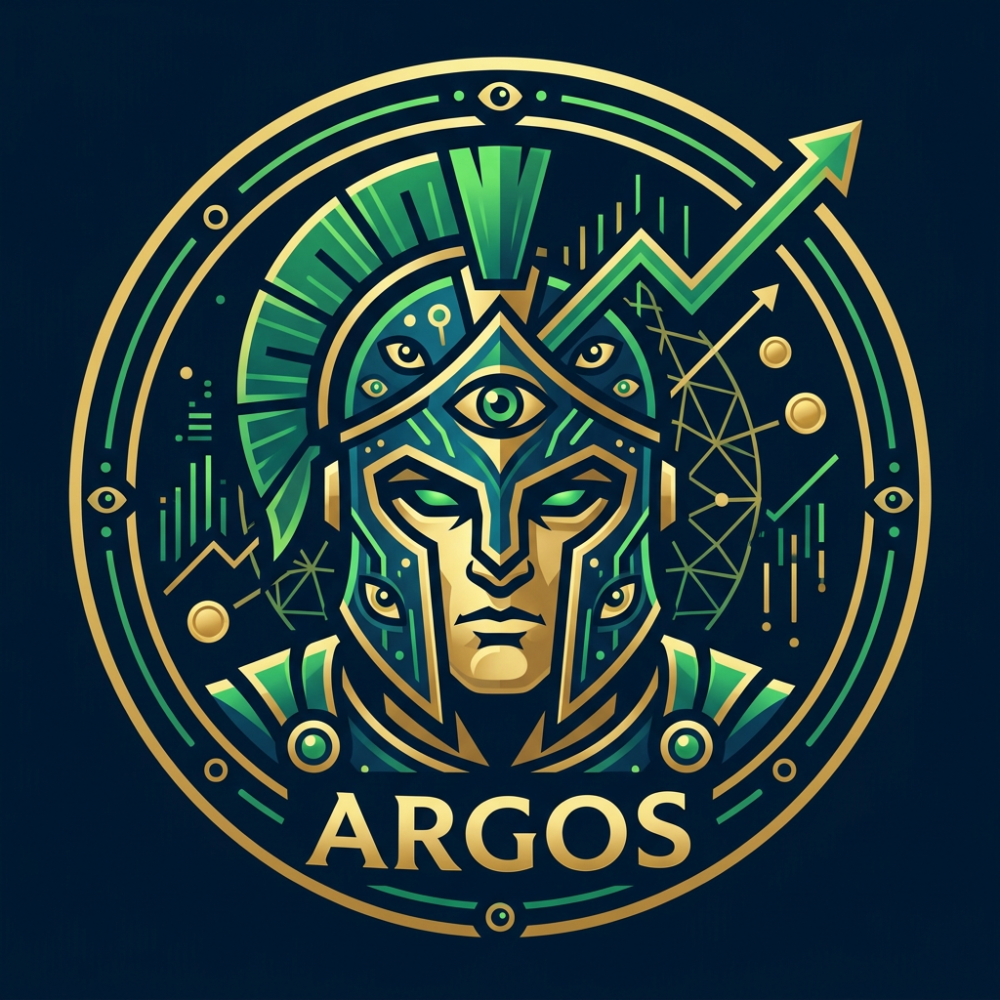

<p align="center">
  
</p>

# Argos

A Telegram bot that keeps track of what you spend. Send it a receipt — a photo, a PDF or a line
of text — and Claude reads it into a SQLite database.

## Argos Lore

In Greek myth, Argos Panoptes — *the all-seeing* — was a giant with a hundred eyes, set by Hera
to guard Io. He never slept with all of them at once: some were always open, so nothing slipped
past him. When Hermes finally lulled him to sleep and killed him, Hera set his eyes on the
peacock's tail, where they still are. This Argos keeps the same watch over your money: every
receipt is seen, read and remembered.

## Install

You need Docker, a bot of your own from [@BotFather](https://t.me/BotFather), your numeric id
from [@userinfobot](https://t.me/userinfobot) and an Anthropic API key from
[platform.claude.com](https://platform.claude.com).

```sh
mkdir -p config/argos/data
curl -fsSL -o config/argos/.env https://raw.githubusercontent.com/DeLucca990/argos-finance-bot/main/.env.example
chmod 600 config/argos/.env   # TELEGRAM_BOT_TOKEN, TELEGRAM_ALLOWED_USER_IDS, ANTHROPIC_API_KEY
```

A `compose.yml` beside `config/`:

```yaml
services:
  argos:
    image: pedrodl/argos-bot:latest
    container_name: argos
    user: "1000:1000"   # the owner of config/argos/data: id -u, id -g
    env_file: ./config/argos/.env
    volumes:
      - ./config/argos/data:/data
    restart: unless-stopped
```

```sh
docker compose up -d                          # start
docker compose pull && docker compose up -d   # update
```

Then send the bot `/start`. On a Mac or Windows the data goes in a volume instead — see
[docs/INSTALL.md](docs/INSTALL.md).

## Using it

Send a receipt — a photo, an image or PDF file, or text such as *almoço 35,90 no pix* — and it
is saved and answered with a card; reply to the card to correct it. Ask in plain words: *quanto
gastei com mercado em setembro?* Add categories of your own with the ➕ at the bottom of
`/categorias`. `/help` lists the commands.

## More

- [docs/INSTALL.md](docs/INSTALL.md) — Mac and Windows, `docker run`, image tags, backups
- [docs/DETAILS.md](docs/DETAILS.md) — every setting and command, the database, running from source
