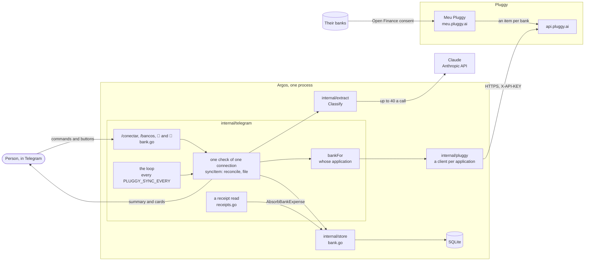
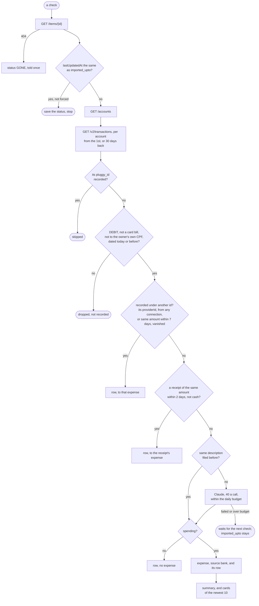
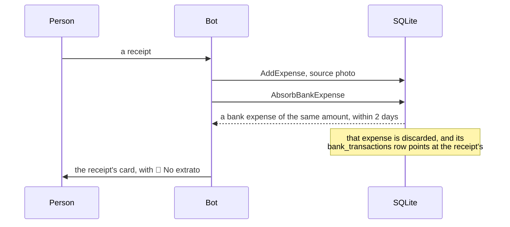
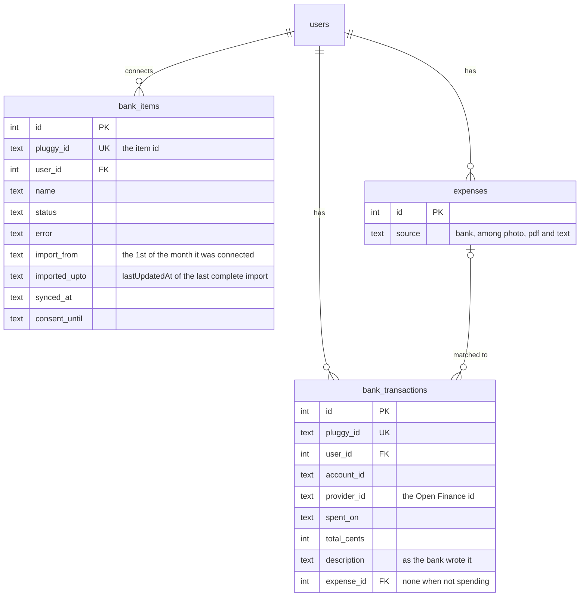

# Pluggy — the API as Argos uses it

What the bot asks [Pluggy](https://pluggy.ai) for, how, and what it needs before it can. How the
imports behave for the person using the bot — what comes in, what is left out, how receipts and the
bank are kept apart — is in [DETAILS.md](DETAILS.md#importing-from-the-bank). The code is
`internal/pluggy/pluggy.go` (the HTTP client) and `internal/telegram/bank.go` (what is done with
the answers).

Pluggy's own reference: [docs.pluggy.ai/en/reference](https://docs.pluggy.ai/en/reference).

## Architecture

All of it runs inside the bot's one process, and nothing in it listens: the bot asks Pluggy, on a
timer or when someone asks it to, and Pluggy never calls the bot.



| Where | What it does |
| --- | --- |
| `internal/pluggy/pluggy.go` | the HTTP client: signs in, keeps the API key, follows the cursor; knows nothing of the bot |
| `internal/telegram/bank.go` | `/conectar`, `/bancos` and its buttons; the loop; picking each person's client; turning transactions into expenses; the messages |
| `internal/telegram/receipts.go` | after a receipt is saved, has the store take over an imported expense of the same purchase |
| `internal/extract/statement.go` | the integration's one call to Claude: files up to 40 transactions |
| `internal/store/bank.go` | the two tables, and the queries that recognise a transaction, or a purchase, already recorded |
| `internal/telegram/config.go` | the credentials, by person, and `PLUGGY_SYNC_EVERY` |

### Whose application

At startup the bot makes a `pluggy.Client` for each application in `.env`: the pair without a
Telegram id, and one per `PLUGGY_CLIENT_ID_<id>`. `bankFor` picks, by Telegram id, the person's own,
else the shared one, else none — and then `/bancos` and `/conectar` tell them which two lines to
add. Everything done for a connection goes through its owner's client, and each client keeps its
own API key.

### One check of one connection

The loop starts one, every `PLUGGY_SYNC_EVERY`, for each connection of someone in the allowlist who
has an application; `/conectar` and 🔄 start one at once, forced past the "nothing changed" stop.
Checks run one at a time, each with five minutes; the call to Claude waits for one of the two
slots receipts use too.



Every transaction that reaches a decision gets a row in `bank_transactions` — pointing at its own
expense, at a receipt's, at the one recorded under its old id, or at nothing when it is not
spending — and the next read skips it by its id. One dropped by the first test gets no row, and is
tested again on every read. From the loop, the summary and the cards go out only when there is a
new expense; `/conectar` and 🔄 always answer.

### A receipt after the bank



### The data



`bank_transactions` has no key to `bank_items`: disconnecting deletes the connection and keeps its
transactions, so connecting it again imports nothing twice. Claude's filing is one row of
`extractions` per call, of kind `bank` and with no expense: `/cost` counts it, and no card shows it.

## Requirements

**A Pluggy account and an application, per person.** At
[dashboard.pluggy.ai](https://dashboard.pluggy.ai), *Applications* lists each application with its
**Client ID**; its page generates the **Client Secret**, shown once — a lost one is replaced by a
new one. Each person reads their own banks through an application on their own account, so each
has a pair.

**Meu Pluggy, for real banks.** [Meu Pluggy](https://docs.pluggy.ai/en/docs/guides/meu-pluggy-personal-use)
is Pluggy's free personal use:

- up to 5 connections, no commercial use, your own accounts only;
- the Meu Pluggy account is the same as the dashboard's;
- banks are connected at [meu.pluggy.ai](https://meu.pluggy.ai), then brought into the
  application from its *Demo* page → *Connect Account* → **MeuPluggy**; each bank becomes an
  **item**, which mirrors Meu Pluggy, refreshes itself every 24 hours and cannot be refreshed by
  the API;
- the application's authorisation lasts **one year** (`consentExpiresAt` on the item). Past it,
  reads come back empty and the item turns `LOGIN_ERROR` with the code
  `USER_AUTHORIZATION_EXPIRED`; renewing is the *Demo* step again, and the item id may change.

**The item id**, copied from the *Demo* page → *Connected Items* → the item. `GET /v2/items` is not
available to Meu Pluggy accounts, so the bot cannot list them: the id is pasted into `/conectar`.

**For testing, the Sandbox.** [Sandbox](https://docs.pluggy.ai/en/docs/guides/sandbox) works on
any plan: on the *Demo* page, search *Sandbox*; the item is called *Pluggy Bank*. User
`user-ok`, password `password-ok`, MFA `123456`. It has a checking account and a credit card with
made-up transactions, refreshed weekly; a sandbox item not updated for 30 days is deleted.

**The bot's configuration**, in `.env`:

| Variable | |
| --- | --- |
| `PLUGGY_CLIENT_ID` / `PLUGGY_CLIENT_SECRET` | the application of everyone in the allowlist without one of their own |
| `PLUGGY_CLIENT_ID_<telegram id>` / `PLUGGY_CLIENT_SECRET_<telegram id>` | the application of that person, who must be in `TELEGRAM_ALLOWED_USER_IDS` |
| `PLUGGY_SYNC_EVERY` | how often to ask Pluggy about each connection: `1h` unless set, whole minutes, at least `1m` |

Each pair is both or neither; startup names any variable that breaks that, a suffix that is not a
numeric id, or an id not in the allowlist. Secrets go in `.env` only, never through the chat.

**The network**: outbound HTTPS to `api.pluggy.ai`, nothing inbound. The bot asks; it registers no
webhook, so it needs no public address or open port.

## The calls

Base URL `https://api.pluggy.ai`. Every request sends `Accept: application/json`, and every one but
`/auth` sends the API key as `X-API-KEY`. Each request has a minute to answer, and an answer over
32 MB is cut off.

| Call | Pluggy reference | When |
| --- | --- | --- |
| `POST /auth` | [Create API Key](https://docs.pluggy.ai/en/reference/auth/auth-create) | before the first call, then whenever the key is 100 minutes old or refused |
| `GET /items/{id}` | [Retrieve Item](https://docs.pluggy.ai/en/reference/items/items-retrieve) | on `/conectar`, then every `PLUGGY_SYNC_EVERY` (an hour unless set) for each connection |
| `GET /accounts?itemId={id}` | [List Accounts](https://docs.pluggy.ai/en/reference/account/accounts-list) | only when the item changed since the last import, on `/conectar` and on 🔄 |
| `GET /v2/transactions?accountId={id}&dateFrom={date}` | [List Transactions](https://docs.pluggy.ai/en/reference/transaction/transactions-list-by-cursor) | right after `/accounts`, once per account, page after page |

A check with nothing new is one call per connection. On a day the bank refreshed, it is
`2 + accounts` calls, more if an account has over a page of transactions. The examples below show
only the fields the bot reads; Pluggy sends more.

### `POST /auth`

Trades the application's credentials for an API key. Pluggy says a key lasts two hours; the bot
keeps one for 100 minutes, then asks again. A call answered `401` or `403` drops the key, gets a
new one and is tried once more — a key refused twice is an error.

```http
POST /auth
Content-Type: application/json

{"clientId": "<client id>", "clientSecret": "<client secret>"}
```

```json
{"apiKey": "eyJhbGciOi..."}
```

A wrong pair answers `401` with a `message`, which the bot logs:
`pluggy: signing in with the client id and secret: pluggy answered 401 Unauthorized: Invalid credentials`.

### `GET /items/{id}`

The item's state. On `/conectar` it checks that the id exists in that person's application; every
check it decides whether there is anything to read.

```json
{
  "id": "6f1b8a3e-2c4d-4e5f-8a9b-0c1d2e3f4a5b",
  "connector": {"id": 200, "name": "MeuPluggy"},
  "status": "UPDATED",
  "executionStatus": "SUCCESS",
  "error": null,
  "lastUpdatedAt": "2026-10-20T09:12:30.123Z",
  "consentExpiresAt": "2027-10-20T09:00:00.000Z"
}
```

| Field | Used for |
| --- | --- |
| `connector.name` | the connection's name in `/bancos` and the account on each expense — except `MeuPluggy`, which names no bank, where the accounts' own names are used |
| `status` | `UPDATED` is up to date; `UPDATING`, `CREATING`, `MERGING` are updating; `LOGIN_ERROR`, `OUTDATED` and `WAITING_USER_INPUT` are trouble, told to the person once when the item turns to one |
| `error.message`, else `error.code` | shown with the trouble |
| `lastUpdatedAt` | compared, to the second, with the one of the last complete import (`bank_items.imported_upto`): the same means there is nothing new, and the check stops here |
| `consentExpiresAt` | `/bancos` warns in its last 30 days |

The id is checked to be a UUID before any call, and lower-cased. A `404` makes the connection
`GONE` — *a Pluggy não encontra mais o item* — which is also what an item looks like after its
owner's credentials change to an application that does not have it.

### `GET /accounts?itemId={id}`

```json
{
  "page": 1, "total": 2, "totalPages": 1,
  "results": [
    {"id": "f1c0...", "type": "BANK", "subtype": "CHECKING_ACCOUNT", "name": "Conta Corrente",
     "marketingName": null, "number": "0001/12345-0", "taxNumber": "123.456.789-09", "currencyCode": "BRL"},
    {"id": "a9d2...", "type": "CREDIT", "subtype": "CREDIT_CARD", "name": "Nubank Mastercard",
     "marketingName": "Ultravioleta", "number": "9876", "taxNumber": "123.456.789-09", "currencyCode": "BRL"}
  ]
}
```

| Field | Used for |
| --- | --- |
| `id` | the `accountId` of the transactions call |
| `type` | `CREDIT` makes every purchase *Crédito*, with the card's digits; `BANK` takes the method from each transaction |
| `subtype` | `SAVINGS_ACCOUNT` is described to Claude as *poupança*, other bank accounts as *conta corrente* |
| `marketingName`, else `name` | the account's name, where the connector's says nothing |
| `number` | a card's last four digits, when the transaction does not name the card |
| `taxNumber` | the owner's CPF: a Pix to it is a transfer between their own accounts |
| `currencyCode` | the currency of `amountInAccountCurrency` |

Only the first page is read; an item has a handful of accounts.

### `GET /v2/transactions`

| Parameter | Value |
| --- | --- |
| `accountId` | from `/accounts` |
| `dateFrom` | `YYYY-MM-DD`: on the first import, the 1st of the month the item was connected; after that, 30 days before the last read, or that 1st, whichever is later |
| `after` | the cursor of the next page, taken from the previous answer's `next` |

`next` is a ready query string — `?accountId=...&after=...` — or `null` on the last page. The bot
takes the decoded `after` out of it and asks again, up to 40 pages (Pluggy's pages hold up to 500);
past that it gives up rather than loop. The page-numbered `GET /transactions` is not used: Pluggy
removes it after 2026-12-31.

```json
{
  "results": [
    {
      "id": "3b5e...", "providerId": "NU-8f2a...", "description": "IFD*IFOOD",
      "date": "2026-10-19T18:04:00.000Z", "amount": 35.9, "amountInAccountCurrency": null,
      "currencyCode": "BRL", "type": "DEBIT", "status": "PENDING", "category": "Food delivery",
      "operationType": "PAGAMENTO",
      "creditCardMetadata": {"installmentNumber": null, "totalInstallments": null, "cardNumber": "5678"},
      "paymentData": null,
      "merchant": {"name": "iFood", "businessName": "IFOOD.COM AGENCIA DE RESTAURANTES ONLINE S.A.", "cnpj": "14380200000121"}
    },
    {
      "id": "c71d...", "providerId": "NU-77b1...", "description": "Pix enviado Maria Souza",
      "date": "2026-10-18T00:00:00.000Z", "amount": -120, "currencyCode": "BRL",
      "type": "DEBIT", "status": "POSTED", "operationType": "PIX",
      "paymentData": {
        "paymentMethod": "PIX",
        "payer": {"name": "Ana", "documentNumber": {"type": "CPF", "value": "123.456.789-09"}},
        "receiver": {"name": "Maria Souza", "documentNumber": {"type": "CPF", "value": "529.982.247-25"}}
      }
    }
  ],
  "next": null
}
```

**Left out before anything else**, and not recorded, so they are looked at again each read:
`type` other than `DEBIT`; `operationType` `PAGAMENTO_FATURA`; a payment whose receiver has the
payer's document, or the account owner's `taxNumber` — a transfer between their own accounts; an
amount that is zero or not a number; a `date` after today — installments still to come. `PENDING` and `POSTED` are both taken.

**Each remaining one** becomes an expense — or is recognised as one already recorded:

| Field | Becomes |
| --- | --- |
| `id` | `bank_transactions.pluggy_id`: a transaction whose id is there is skipped |
| `providerId` | `bank_transactions.provider_id`: a transaction whose Open Finance id is there for the same person, from any connection, takes that row's expense — Pluggy's ids change when an item is connected again, this one does not |
| `date` | `spent_on`, and `spent_time` when it has one. Pluggy sends UTC: midnight UTC is read as a bare date; any other instant is converted to local time, and a time is kept unless it is local midnight |
| `amountInAccountCurrency`, else `amount` | `total_cents`, without its sign — positive for card purchases, negative for account debits |
| the account's `currencyCode` with `amountInAccountCurrency`, else `currencyCode` | `currency` |
| `paymentData.paymentMethod`, else `operationType` | on a bank account: `PIX` → *Pix*, `BOLETO` and `CONVENIO_ARRECADACAO` → *Boleto*, `CARTAO` → *Débito*, anything else none |
| `creditCardMetadata.cardNumber`, else the account's `number` | `card_last4`, on a card |
| `paymentData.receiver.documentNumber.value`, else `merchant.cnpj` | `merchant_tax_id`, when it is a valid CPF or CNPJ |
| `creditCardMetadata.installmentNumber` / `totalInstallments` | *parcela 3/10* in the description |
| `description` | shown to Claude; kept in `bank_transactions.description`, where the next transaction with the same one is filed like it; shown on the card as *🏦 No extrato* |
| `paymentData.receiver.name`, else `merchant.name` or `businessName` | shown to Claude as who was paid |
| `category` | shown to Claude as the bank's suggestion — Pluggy fills it only on its Pro plan |

Claude answers the merchant's name, the description, the category and whether it is spending at
all, for up to 40 transactions a call. Its schema and prompt are in `internal/extract/statement.go`.
